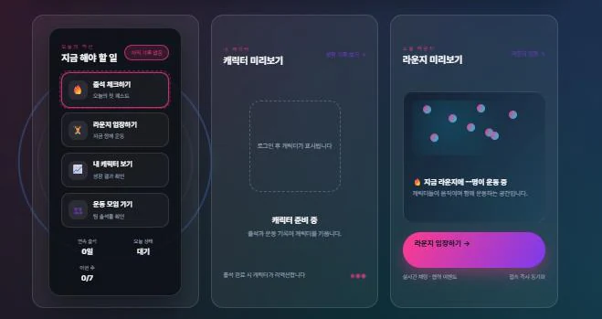
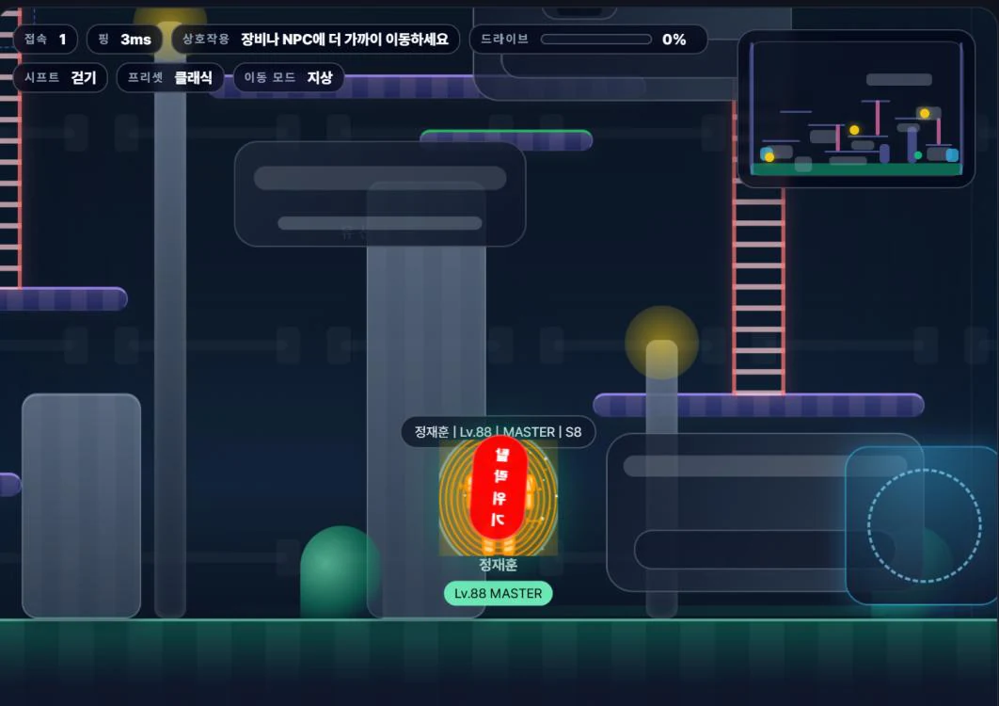
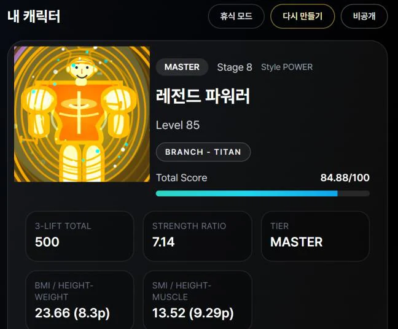
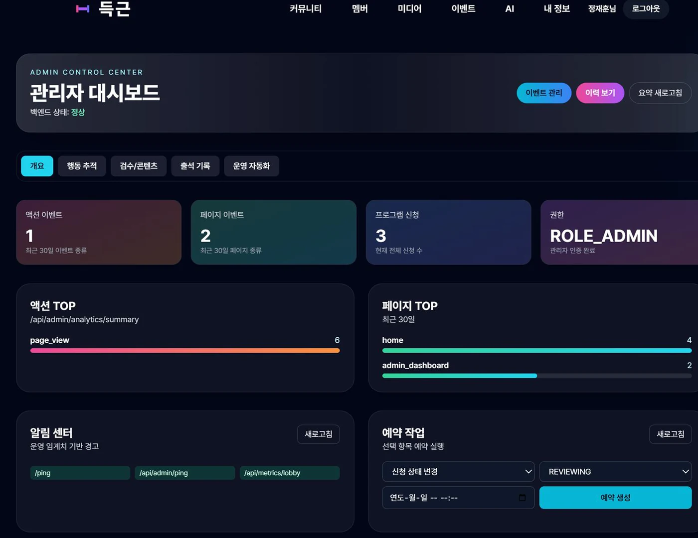
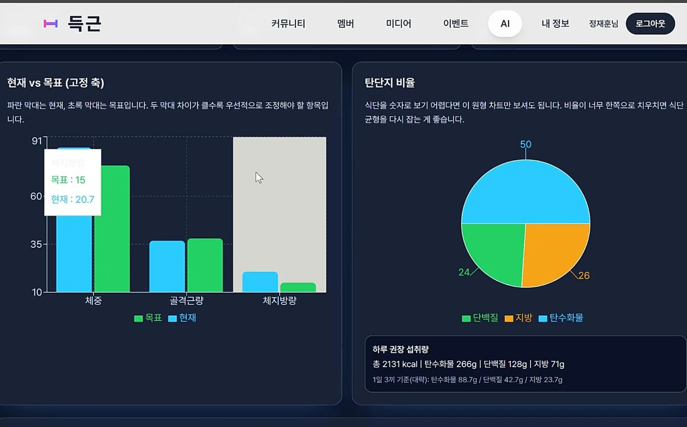
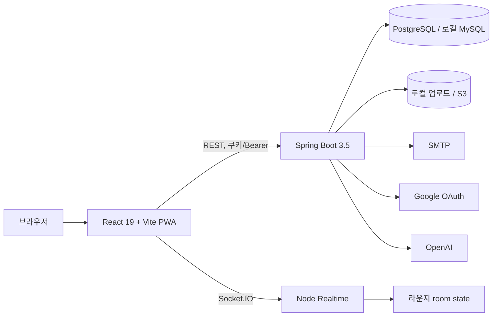

# 득근득근 MuscleUp

운동 기록이 캐릭터 성장과 랭킹, 실시간 라운지로 이어지는 피트니스 커뮤니티입니다. 혼자 기획하고 만들고 배포해서 실제 회원 약 50명이 쓰고 있습니다.


| | |
|---|---|
| 기간 | 2025.09 ~ (첫 커밋 2025-09-03, 커밋 189개) |
| 인원 | 1명. 기획, UI, API, 인증, 배포, 운영 전부 |
| 배포 | https://ajou-muscle-up.vercel.app (프론트 Vercel, 백엔드 Railway, PostgreSQL) |
| 영상 | https://youtu.be/0X-BIADC1eQ |

## 주요 코드

1. [`RefreshTokenService.rotate()`](backend/src/main/java/com/ajou/muscleup/service/RefreshTokenService.java#L39-L51). 교과서대로 넣었던 Refresh 토큰 로테이션을 하루 만에 걷어낸 자리입니다. 이유는 아래 "Refresh 로테이션을 뺀 이유"에 있습니다.
2. [`docs/BENCHMARKS.md`](docs/BENCHMARKS.md). 이 저장소가 주장하는 성능 수치 두 개를 직접 다시 잴 수 있는 스크립트와 실측표입니다. 쿼리는 700배 빨라졌는데 사용자 체감은 2배인 이유도 거기에 있습니다.
3. [`realtime/src/server.ts`](realtime/src/server.ts). REST와 분리한 Socket.IO 라운지 서버입니다. 60ms 간격으로 돌고, 바뀐 것이 있을 때만 브로드캐스트합니다. 100명에서 성능이 꺾이는 것과 그 원인이 CPU가 아니라는 것까지 측정해 두었습니다.

## 주요 화면

| | |
|---|---|
|  |  |
| 첫 화면은 서비스 소개가 아니라 오늘의 할 일 목록입니다. 출석이 메인 액션이고 나머지 퀘스트가 그 아래에 있습니다. | 라운지입니다. 캐릭터가 같은 공간을 돌아다니고, 채팅과 이모트, 스티커, 파티 요청이 Socket.IO로 오갑니다. 왼쪽 위가 접속자 수와 핑입니다. |
|  |  |
| 운동 기록이 캐릭터로 표현됩니다. 티어, 단계, 점수는 `character_profiles` 컬럼 값 그대로입니다. 공개로 설정하면 랭킹에 오릅니다. | 관리자 화면은 조회용이 아니라 운영 콘솔입니다. 감사 로그, 신고 콘텐츠 검수, 프로그램 신청 상태, 이벤트 CMS, 예약 작업이 있습니다. |

이 밖에 이메일 인증과 Google 로그인, 월간 출석 로그와 연속 출석, 크루(초대코드, 가입 승인, 챌린지), 운동 자랑 게시판, 단백질 나눔, AI 인바디 분석(이미지와 PDF)과 운동 계획, 공유 링크, 로컬과 S3 이중 업로드가 있습니다.



## 1.0 사용자 피드백과 2.0에서 반영한 것

1.0은 기능을 소개하고 분위기를 전달하는 랜딩 페이지였습니다. 그때는 그게 맞다고 생각했습니다. 써 본 사람들이 남긴 말이 네 가지 있었고, 그 말을 바탕으로 2.0을 만들었습니다.

| 사용자가 한 말 (1.0 발표자료 p.24) | 2.0에서 한 것 |
|---|---|
| "처음 사용할 때 어디서 뭘 해야 할지 몰랐어요" | 홈을 로비로 바꿨습니다. "오늘 출석 시작"이 첫 화면의 메인 액션이 됐습니다. |
| "다른 사람들과 더 많이 소통하고 싶어요" | 게시판으로는 같이 있다는 느낌이 안 났습니다. 실시간 라운지와 크루를 만들었습니다. |
| "내 운동 데이터를 더 자세히 보고 싶어요" | 숫자를 더 보여 주는 대신 기록이 자라는 것이 보이게 했습니다. 캐릭터 레벨, 티어, 진화, 공개 랭킹입니다. |
| "AI 답변이 나올 때까지 기다리는 게 길어요" | 아직 못 했습니다. 2.0에서 AI는 인바디 OCR이 추가되어 오히려 무거워졌습니다. 스트리밍 응답과 캐싱이 다음 과제입니다. |

네 가지 중 세 가지를 반영했습니다. 못 한 하나도 그대로 적어 두었습니다.

## 구조



REST와 실시간을 다른 프로세스로 둔 이유가 있습니다. 라운지는 플레이어 위치, 채팅, 이모트처럼 초당 여러 번 바뀌는 상태이고, 나머지는 하루에 몇 번 바뀌는 상태입니다. 한 서버에 두면 위치 브로드캐스트가 인증, 출석, 게시판 요청과 같은 스레드 풀을 두고 경쟁합니다. 그래서 라운지 서버는 DB를 모릅니다. `lounge:join` 때 받은 프로필을 메모리의 room에 들고 있다가 `/status`로 접속자 수만 돌려줍니다.

| 백엔드 | 프론트 | 실시간 |
|---|---|---|
| Java 17, Spring Boot 3.5, Spring Security, JPA, JWT, PDFBox, AWS SDK S3 | React 19, TypeScript, Vite, TanStack Query, Tailwind, Recharts, Socket.IO client, Vite PWA | Node, TypeScript, Socket.IO 4 |
| 컨트롤러 28개, 엔티티 32개, 마이그레이션 SQL 13개 | 페이지 36개 | 소켓 이벤트 16개 |

## Refresh 로테이션을 뺀 이유

Access 토큰은 짧게, Refresh 토큰은 HttpOnly 쿠키로 길게 두는 것까지는 교과서대로입니다. 1.0에서는 한 발 더 나가서, Refresh 토큰을 쓸 때마다 새 토큰으로 갈아끼우는 로테이션을 넣었습니다. 훔친 Refresh 토큰이 두 번째 사용부터 401이 되니 보안 문서에 쓰기 좋은 기법입니다.

운영에서는 장애가 됐습니다. 홈 로비는 뜨자마자 출석 로그, 출석 요약, 캐릭터, 통계를 `Promise.all`로 동시에 부릅니다([`Home.tsx#L202`](frontend/src/pages/Home.tsx#L202)). Access 토큰이 만료된 순간이면 네 요청이 동시에 401을 받고 동시에 `/refresh`를 호출합니다. 첫 요청이 토큰을 갈아끼우면 나머지 셋은 방금 폐기된 토큰을 들고 오니 401이 됩니다. 사용자 입장에서는 아무 이유 없이 로그아웃되는 것입니다.

2026-04-01에 넣었고([`72b38fa`](https://github.com/toadsam/Ajou_MuscleUp/commit/72b38fa)) 같은 날 걷어냈습니다([`bacef85`](https://github.com/toadsam/Ajou_MuscleUp/commit/bacef85)). 서버는 Refresh 토큰을 그대로 유지하고, 대신 클라이언트가 재발급 요청을 한 번만 보내게 했습니다. fetch 래퍼는 `refreshPromise` 하나를 공유하고([`installFetchAuth.ts#L101`](frontend/src/lib/installFetchAuth.ts#L101)), axios 쪽은 `refreshing` 플래그와 대기열로 같은 일을 합니다([`api.ts#L47`](frontend/src/lib/api.ts#L47)). 재사용 탐지는 포기했지만 Refresh 토큰은 여전히 서버 저장소에서 폐기되고 만료됩니다.

동시성을 먼저 확인하고 나서 보안 기법을 골라야 한다는 것을 배웠습니다.

## 성능 측정

재현 절차와 주의할 점, 원본 수치는 전부 [`docs/BENCHMARKS.md`](docs/BENCHMARKS.md)에 있습니다. 여기에는 결론만 적습니다.

### 목록 4개에 인덱스 추가. 쿼리는 700배, 사용자 체감은 2배

자랑방, 공개 랭킹, 공유 인증 관리, 프로그램 신청 목록은 전부 `Pageable`인데 정렬 컬럼에 인덱스가 없었습니다. 회원이 50명이라 아무 화면도 느리지 않았지만, 문제가 생기기 전에 확인하려고 표당 20만 행을 넣고 측정했습니다.

| 쿼리 | 인덱스 없음 | 인덱스 + VACUUM |
|---|---:|---:|
| 자랑방 목록 | 60.21ms | 0.084ms |
| 공개 캐릭터 랭킹 | 58.56ms | 0.045ms |
| 프로그램 신청 | 56.87ms | 0.023ms |
| `count(*)` | 57.21ms | 57.45ms |

(PostgreSQL 17.4, 표당 20만 행, 7회 중앙값, 2026-09-02)

목록 쿼리는 700~2500배 빨라졌는데 `Page<T>`가 같이 실행하는 `count`는 그대로입니다. 그래서 한 페이지 응답은 117ms에서 57ms로 2배 빨라지는 데 그쳤습니다. 이제 페이지 시간의 99.9%가 count이고, 다음 병목은 정렬이 아니라 카운트입니다. 인덱스 4개가 차지하는 디스크 21MB(표 239MB)도 같이 적었습니다. 한 번은 인덱스를 넣었더니 count가 2.6배 느려진 적이 있는데, `VACUUM`을 빼먹어서 visibility map이 없었고 `Index Only Scan`이 힙을 다시 읽은 것이었습니다. 이 경우도 문서에 있습니다.

### 라운지 동시접속. 100명에서 꺾이고 원인은 CPU가 아님

앱이 이미 가진 `ping:check` 왕복으로 25명부터 300명까지 올리며 측정했습니다.

| 접속 | p95 | 서버 송신 | 1인당 바이트 | CPU |
|---:|---:|---:|---:|---:|
| 50 | 9ms | 12.2MB/s | 795 | 4.7% |
| 100 | 85ms | 63.3MB/s | 795 | 12.2% |
| 200 | 1115ms | 216.8MB/s | 796 | 13.5% |
| 300 | 55818ms | 376.1MB/s | 797 | 18.9% |

(서버 한 대, 루프백, 16초 × 3회 중앙값, 2026-09-02)

설계 주기가 60ms라서 p95가 그 근처를 넘으면 체감이 깨집니다. 50명까지는 여유가 있고, 100명에서 이미 넘고, 300명에서는 사실상 동작하지 않습니다. 1인당 바이트는 795로 고정인데 서버 송신량만 140배 뛴 것이 핵심입니다. 매 틱마다 전원에게 전원 목록을 보내니 전송량이 N²으로 커집니다. 무너질 때 CPU가 18.9%밖에 안 되는 것이 그 증거입니다. 연산이 막힌 것이 아니라 전송이 밀리는 것이라 서버를 늘려도 해결되지 않습니다. 고칠 곳은 페이로드입니다(변경분만 보내기, 관심 영역 제한). 아직 안 고쳤고, 회원 50명 규모에서 먼저 고칠 일은 아니라고 판단했습니다.

## 배포 중 겪은 문제

1.0은 Route 53, ACM, CloudFront, S3 정적 배포에 RDS를 붙였고, 지금은 Vercel과 Railway입니다. 그 사이에 세 번 막혔습니다.

- 인증서를 발급했는데 CloudFront가 못 고르는 문제. CloudFront는 us-east-1 인증서만 봅니다. 다른 리전에서 발급하면 잘못됐다는 표시 없이 그냥 목록에 안 나옵니다.
- 배포했는데 옛 화면이 나오고, 사람마다 다르게 보이는 문제. 엣지마다 캐시가 달랐습니다. Invalidation(`/*`)을 배포 절차에 넣었습니다.
- 키 하나가 없어서 서버가 아예 안 뜨는 문제. 로컬과 운영 설정이 한 파일에 섞여 있었습니다. prod 프로파일을 분리하고 값은 전부 `${ENV_VAR}`로만 받게 했습니다. CORS 허용 목록도 같은 이유로 코드에서 빼서 `cors.allowed-origins` 설정으로 옮겼습니다. 프론트와 API 도메인이 갈리면서 `setAllowCredentials(true)` 없이는 쿠키가 안 실리는 것도 이때 알았습니다.

## 남은 과제

- 피드백 네 번째 항목인 AI 응답 속도. 스트리밍과 캐싱을 아직 안 했습니다.
- 페이지네이션의 count. 커서 방식이나 근사 카운트로 바꿔야 합니다.
- 라운지 브로드캐스트가 N²입니다. 델타 전송으로 바꿔야 100명을 넘길 수 있습니다.
- 자동화된 테스트가 사실상 없습니다. `backend/src/test`에는 컨텍스트 로드 하나와 AI 인바디 품질 하네스뿐입니다. 품질은 [`docs/inbody-quality-playbook.md`](docs/inbody-quality-playbook.md)의 8개 케이스를 손으로 돌려 봤습니다.
- 초기 커밋 메시지가 성의 없습니다. 혼자 빠르게 개발하던 시기의 흔적이고, 2026년 8월부터는 무엇을 왜 바꿨는지 적고 있습니다.

## 실행하기

<details>
<summary>세 프로세스를 띄웁니다. 백엔드 8080, 실시간 4001, 프론트 5173</summary>

필요한 것: Java 17, Node 20 이상, MySQL 또는 PostgreSQL. 이메일 인증, Google 로그인, AI, S3는 키가 있을 때만 켜집니다.

**백엔드.** `backend/src/main/resources/application-local.example.properties`를 `application-local.properties`로 복사해 값을 채웁니다(Git에서 제외되어 있습니다).

```properties
spring.datasource.url=jdbc:mysql://localhost:3306/muscleup?createDatabaseIfNotExist=true&serverTimezone=Asia/Seoul
spring.datasource.username=root
spring.datasource.password=
spring.jpa.hibernate.ddl-auto=update
jwt.secret=충분히_긴_랜덤_문자열
cors.allowed-origins=http://localhost:5173
app.frontend-base-url=http://localhost:5173
app.cookie.secure=false
app.cookie.same-site=Lax
# 선택: spring.mail.* / openai.api.key / google.client-id, google.client-secret / app.s3.*
```

```bash
cd backend && ./gradlew bootRun        # Windows: .\gradlew.bat bootRun
```

**실시간 서버.** `PORT`(기본 4001)와 `ORIGIN`(기본 http://localhost:5173)만 봅니다.

```bash
cd realtime && npm install && npm run dev
```

**프론트.** `VITE_API_BASE`, `VITE_REALTIME_URL`이 비어 있으면 위 기본 주소를 씁니다. Google 로그인은 `VITE_GOOGLE_CLIENT_ID`가 필요합니다.

```bash
cd frontend && npm install && npm run dev
```

운영 프로파일(`application-prod.properties`)은 DB, 메일, OpenAI, Google, JWT, S3 값을 전부 환경변수로만 받습니다. 벤치마크는 [`docs/BENCHMARKS.md`](docs/BENCHMARKS.md) 절차대로 하되, 운영 DB에서는 돌리지 않습니다.

</details>

<details>
<summary>폴더</summary>

```text
backend/   Spring Boot. config(Security, JWT, CORS), controller, service, entity, repository, sql(마이그레이션, bench)
frontend/  React. pages(36), components, lib(api.ts, installFetchAuth.ts), services, layouts
realtime/  Socket.IO. server.ts(이벤트, 60ms 틱), rooms.ts(room state), bench(부하 스크립트)
docs/      BENCHMARKS.md, inbody-quality-playbook.md, 홈페이지 마스터 문서, screenshots
```

</details>

## 만든 사람

정재훈, 아주대학교. 다른 작업은 [포트폴리오](https://jaehun.co.kr)와 [GitHub](https://github.com/toadsam)에 있습니다.

코드와 화면은 포트폴리오 공개 목적이며, 별도 표기 전까지 무단 사용, 복제, 배포를 허용하지 않습니다.
