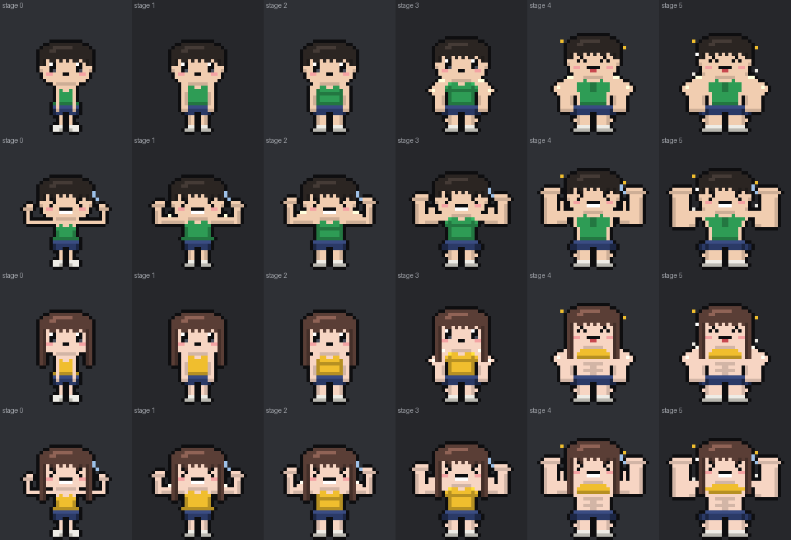
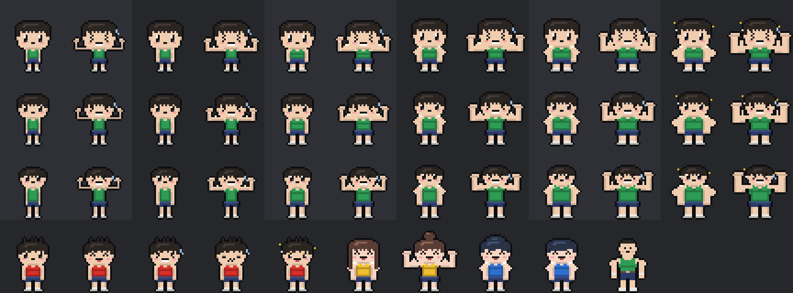
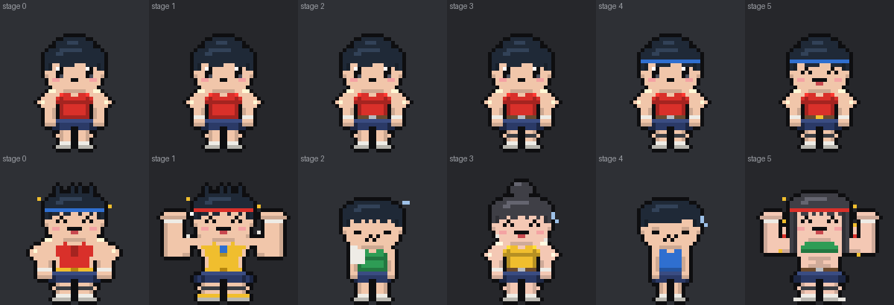

# 설계 — 캐릭터 새 그림: 머리 큰 귀여운 치비 + 레벨 · 성장으로 확실히 바뀌는 몸

작성 2026-10-20. 사용자 요청: "캐릭터 디자인에 더 투자하고 싶다. 코드로 그리되 코드로 낼 수 있는 최고로, 귀엽게, 얼굴은 지금보다 크게. 레벨이나 성장에 따라 몸도 확실하게 바뀌었으면."
지금은 **시안 단계**다 — `/dev/avatars` 맨 위 "치비 시안" 줄에서만 그리고, 실제 화면은 아직 기존 `AvatarRenderer`.

**결정(사용자, 2026-10-20): 비율 B 2.5등신.** 그리고 "단계가 바뀔 때마다 더 다이나믹하게" → 아래 2.1 단계 표로 다시 그림.

B 단계 그림: 
(줄: 남 서기 · 남 알통 · 여 서기 · 여 알통, 칸: 몸 단계 0 → 5)

처음 시안(비율 3안): 
(위에서부터 시안 A · B · C, 왼쪽부터 몸 단계 0 → 5, 각 단계 서기 · 알통 자세. 맨 아래: 표정 5가지 · 여성 2 · 다른 머리 · 체지방 · 맨 오른쪽 지금 그림)

---

## 1. 지금 문제 (조사)

| 문제 | 근거 |
|---|---|
| 얼굴이 작다 | `pixelAvatar.ts` 머리 8줄 / 전체 32줄(4등신), 눈 1칸 |
| 레벨이 올라도 몸이 안 변하는 사람이 많다 | 몸 단계 `build`(0~3)가 `AvatarRenderer` 에서 `growthParams.muscularityNormalized`(인바디 골격근량 ÷ 몸무게) 중심으로만 정해진다. 체성분을 안 넣으면 `CharacterGrowthCalculator.zero()` → 근육 0 → 레벨 · 3대 · 출석이 올라도 단계 0 그대로 |
| 그림이 두 벌 | 큰 리프터 24×32(카드 · 전투) vs 작은 리프터 10×16(`gymMap/engine.ts drawChar` — 지도 · 라운지 · 던전). 작은 쪽은 머리 모양 · 체형이 없다 |

## 2. 그림 규칙 (`components/avatar/chibiArt.ts`)

- 같은 24×32 칸 · 같은 `Grid`(좌우 대칭 · 자동 외곽선)를 쓴다 → 기존 `AvatarRenderer` 의 SVG · 효과 · 크기 규칙을 그대로 쓸 수 있다.
- **비율 3안**: A 2등신(머리 14 : 몸 13) · B 2.5등신(12 : 15) · C 3등신(10 : 17).
- **머리**: 만두형(둥근 이마 · 통통한 볼), 머리카락은 얼굴보다 한 칸 넓게 부풀고 윤기 띠, 앞머리 끝은 시드 머리 모양마다 들쭉날쭉(짧은 · 삐죽 · 퐁파두르 · 옆으로 넘김 / 여성 긴 머리 · 똥머리).
- **눈**: 2칸 × 3~4칸, 왼쪽 위 하이라이트 + 아래 반사광. 볼터치. **표정 5가지** 기본 · 웃음(^ ^) · 힘줌(> < + 이 악물기 + 땀) · 지침(반쯤 감김 + 땀) · 반짝(노란 하이라이트).
- **몸 단계 0~5** — 단계마다 한눈에 다르게(2.1)

### 2.1 몸 단계 (B 확정판)

| 단계 | 이름 | 어깨 반폭 | 팔 두께 | 다리 | 키(몸통 줄) | 옷 | 눈에 띄는 변화 |
|---|---|---|---|---|---|---|---|
| 0 | 새싹 | 3 | 1 | 1 | -1 | 헐렁한 민소매(아래 퍼짐) | 가는 목이 보임 · 큰 신발에 가는 다리 |
| 1 | 입문 | 5 | 2 | 2 | 0 | 헐렁한 민소매 | 팔이 생김 |
| 2 | 근력 | 6 | 2 | 3 | 0 | 몸에 붙는 민소매(V) | 둥근 어깨 · 작은 알통 · 가슴선 |
| 3 | 벌크 | 8 | 3 | 3 | +1 | 몸에 붙는 민소매 | 승모가 머리 옆으로 솟음 · 허벅지 · 종아리 · 가슴 윤기 |
| 4 | 괴력 | 9 | 4 | 4 | +2 | 끈 나시(남) · 크롭탑 + 복근(여) | 어깨가 머리보다 넓음 · 팔이 벌어짐 · 반짝 |
| 5 | 전설 | 10 | 5 | 5 | +2 | 끈 나시 · 크롭탑 | 최대 · 알통 봉우리 5 · 김 · 반짝 |

- 셀 셰이딩은 넓은 면 단위로만(점 음영 · 핏줄 점은 얼룩처럼 보여 뺐다).
- 큰 단계(4+)는 알통 아래부터 팔을 한 칸 벌려 겨드랑이 틈을 만든다 → 자동 외곽선이 팔과 몸통을 갈라 한 덩어리로 안 보인다.

- **알통 자세**(더블 바이셉스): 위팔은 옆으로 길게, 팔뚝은 볼 높이까지, 알통 봉우리가 단계마다 커진다. 머리가 커서 주먹이 머리와 겹치지 않게 팔꿈치를 바깥으로 뺐다.
- 셀 셰이딩: 피부 · 민소매 · 반바지 아래쪽 · 안쪽 한 단계 어둡게, 머리카락 · 어깨 · 가슴 하이라이트. 새 색은 볼터치 · 입 · 눈 반사광 정도(짐 플로어 v2 색 체계 유지).

## 3. 몸 단계 정하기 (제안 — `bodyStageOf`)

근육 데이터가 없어도 운동하면 몸이 커지게, **셋 중 가장 높은 단계**:
- 근육량(인바디 `muscularityNormalized` 0~1) → 0~5
- 캐릭터 레벨(1~100, 3대 · 체성분 · 출석) → 10 · 25 · 40 · 60 · 80 에서 한 단계씩
- 활동 레벨(출석 · 주간 목표 · 할 일 점수, 상한 없음 — `ActivityLevel`) → Lv 3 · 6 · 10 · 15 · 22 에서 한 단계씩

활동 레벨 기준이면 주 3번 운동하는 사람이 대략 1주 단계 1, 3주 2, 6주 3, 3달 4, 5달 5. 숫자는 돌려 보고 조정.
지금의 펌핑(운동 직후 1시간 근육 한 단계)은 그대로 +1.

## 4. 다음 순서 (사용자가 시안을 고른 뒤)

> 2026-10-20 진행: **5 움직임 끝** — 통통 걷기 · 숨쉬기(작은 그림 · 카드) · 몸이 커지는 순간 · 이긴 순간([세부](../fixes/2026-10-20-chibi-motion-life.md)).
>
> **모든 화면 같은 캐릭터** — 작은 그림에 머리 모양 · 성별 · 몸 단계 · 머리띠(`avatar/spriteShape.ts`), 라운지 입장권 `bs`, 그림자 보스 · 종목 그림 치비([세부](../fixes/2026-10-20-chibi-everywhere.md)).
>
> **3 · 4 끝**(작은 그림 `drawChar` 치비, 정면 동작 9가지 치비 · 옆모습 16가지 큰 머리 — [세부](../fixes/2026-10-20-chibi-motions.md)). 남은 것: 5 움직임, 옆모습 몸통의 몸 단계.
>
> **1 · 2 끝**(B 확정, 카드 교체 · 서버 `BodyStage` → `AvatarLookService.bodyStage` → 응답 · `AvatarRenderer bodyStage`). 장비 그림: 

1. 비율 하나 고르기(A · B · C) — 얼굴 크기 · 눈 크기 미세 조정
2. 큰 그림 교체: `AvatarRenderer` 가 `buildChibi` 를 쓰게(티어 장비 — 손목 보호대 · 벨트 · 머리띠 · 무릎 보호대 · 금 신발 — 와 휴식 · 경고 · 진화 갈래 마크를 새 비율로 옮김), `bodyStageOf` 로 몸 단계(서버에 활동 레벨이 이미 있어 `/api/character/me` 에 같이 싣기)
3. 작은 그림 통일: 지도 · 라운지 · 던전의 `drawChar`(10×16)를 같은 규칙의 작은 치비로(머리 모양 · 체형 단계가 보이게)
4. 운동 동작 20여 가지 · 기구 · 옆모습(`pixelPoses.ts`)을 새 비율로 — 가장 큰 일, 동작별로 나눠서
5. 움직임: 통통 튀는 걷기 · 숨쉬기 · 레벨업 · 처치 포즈

## 5. 아직 정하지 않은 것

- ~~비율~~ → **B 2.5등신으로 확정**(2026-10-20).
- 몸 단계 기준 숫자, 여성 체형 차이(지금 시안은 머리 모양만 다름).
